<div align="center">


# ZHUANG-AI（庄 AI）· Photoshop AI 修图面板 + 幻梦圆环

**面向 Adobe Photoshop 的原生 UXP AI 修图工作台与画布悬浮预设圆环菜单，以 GPL-3.0 开源。**

打通「选区智能抓取 → 68 条修图预设 / 提示词 → 多渠道并行生图 & 本地 ComfyUI → 精确对齐回贴 + 融合校色 + 白色蒙版组」全流程；
API Key 与历史原图完全留在本地，零构建即改即用，支持 Windows / macOS 双端圆环实时联动。

[](LICENSE)
[](#模块与组件矩阵)
[](#快速开始)
[](#模块与组件矩阵)
[](#本地-comfyui-与内置工作流)
[](#系统架构与工作原理)

</div>

---

> [!CAUTION]
> **使用前请先阅读许可与免责说明：[`LICENSE`](LICENSE) · [`NOTICE`](NOTICE)**
> 本项目为**个人、非官方**的开源 Photoshop AI 修图效率工具，按 GNU GPL-3.0 协议「按现状（AS-IS）」提供，**不提供、不分发** Adobe Photoshop 或任何闭源商业软件。使用第三方 AI 生图 / 对话服务产生的费用、内容合规及版权责任均由使用者自行承担，请严格遵守各服务商条款及当地法律法规。

> [!IMPORTANT]
> **数据隐私与开源边界**
> - **零云端后台与零密钥泄露**：所有 API Key、接口地址、偏好设置仅保存在本机（UXP `localStorage` 与用户目录配置文件），本仓库不包含任何 API Key、授权码、云端地址或签名密钥。
> - **宿主版本要求**：UXP 插件需要 **Adobe Photoshop 26.0 或更高版本**；幻梦圆环为**可选组件**，不启动圆环也能在插件内直接搜索、分类选择与编辑全部预设。
> - **图片传输说明**：执行云端生图或视觉问答时，选区 / 画布图像会直接发送至你自行配置的 AI 服务商接口（本地 ComfyUI 与本地辉光 / 特效工具除外）。

---

## 📖 目录

- [这是什么](#这是什么)
- [核心特性](#核心特性)
- [系统架构与工作原理](#系统架构与工作原理)
- [模块与组件矩阵](#模块与组件矩阵)
- [界面与圆环预览](#界面与圆环预览)
- [快速开始](#快速开始)
- [支持的模型渠道与预设库](#支持的模型渠道与预设库)
- [本地 ComfyUI 与内置工作流](#本地-comfyui-与内置工作流)
- [开发与调试](#开发与调试)
- [项目结构](#项目结构)
- [常见问题](#常见问题)
- [开源组件与致谢清单](#开源组件与致谢清单)
- [许可协议与免责声明](#许可协议与免责声明)

---

## 🎯 这是什么

在 Photoshop 中配合 AI 做人像精修、局部重绘与后期合成，常见痛点非常割裂：反复截选区切网页、来回复制提示词、下载结果再手动拖回 PS 对齐缩放、大图或 16-bit 文档贴偏、换图等待卡死当前工作流、以及多渠道 API 与本地 ComfyUI 切换繁琐。

**ZHUANG-AI** 将这些高频操作收束进一个**微信风原生 UXP 面板**与一个**画布悬浮圆环菜单**中，打造本地优先、精确可控的 Photoshop AI 修图工作流：

```text
传统切窗流：
  PS 截图保存 ──▶ 切网页翻提示词 ──▶ 排队单张出图 ──▶ 下载拖回 PS ──▶ 手动对齐/建组/加蒙版

ZHUANG-AI 一站式流：
  选区自动抓取 ──▶ 幻梦圆环 / 表情包式预设填词 ──▶ 1~8 张并行生图（后台切图不中断）
       ──▶ DOM + batchPlay 二次精确对齐回贴 ──▶ 可选融合校色 ──▶ 自动同名图层组 + 白色蒙版
```

> [!NOTE]
> 主链路聚焦 **预设 → 提示词 → 运行 → 查看 / 回贴 / 保存**；同时内置 **多轮带选区视觉对话、本地 CPU 辉光、图片特效、AI 切片超分** 以及 **本机 / 局域网 ComfyUI 工作流原生直连**，一套面板覆盖日常精修与进阶工作流。

---

## ✨ 核心特性

| 特性 | 说明 |
|---|---|
| 🎯 **精确选区抓取与二次对齐回贴** | 有选区自动抓选区，无选区用整幅画布兜底（直读最长边 1400px，4K 大图秒抓）；回贴先读 DOM 选区、读不到回退 `batchPlay`，经置入 / 缩放 / 栅格化后**再对齐一次目标矩形**，避免大图与 16-bit 文档偏移；回贴结果自动收入同名图层组并附白色蒙版（支持可选融合校色） |
| ⚡ **1–8 张多图并行 + 后台无感切图** | 一次可并行请求 1–8 张（多图渠道走原生 `n` 参数或并发请求），首张按设置自动回贴，其余以卡片展示供挑选「回贴 PS」；生成期间可自由切换修别的文档，回贴时自动切回原文档、贴完再切回你正在编辑的文件 |
| 🌀 **68 条预设 + 幻梦圆环实时联动** | 内置 **23 个分类、68 条**人像/Cos/服装/道具/背景预设；支持微信表情包式面板搜索、分类筛选与增删改，并通过 `ws://127.0.0.1:8799` 与 Windows / macOS 幻梦圆环双向同步，Alt+右键（macOS 为 ⌥+右键）在画布光标处瞬时唤出 |
| 🌐 **7 大云端渠道 + 自定义模型名** | 原生接入 **GRS（17 个图片模型）、Google AI Studio、xAI、火山方舟 SeeDream、Vertex AI、OpenAI 兼容、New API 中转**；各渠道 Key / URL 独立持久化，按模型能力自动夹取 1K/2K/3K/4K 分辨率，支持填写任意自定义模型名 |
| 🧩 **本机 / 局域网 ComfyUI 直连** | 独立侧栏入口，自动读取服务端 `workflows` 目录并转换为 API 格式；内置「图生图带放大」「文生图带放大」两份工作流，仅暴露 `#` 标记参数，点「读取选区」直接以 ArrayBuffer 上传 PS 选区为主图 |
| 🛠️ **本地工具箱与多轮视觉对话** | 内置 **辉光**（柔光/白光/星芒/横向拉丝，本地 CPU 渲染）、**图片特效**（本地热浪/气流/刀光 + AI 能量拖尾/霓虹描边/魔法阵）、**AI 切片超分**（2×/3×/4× 逐块回贴）及 **8 轮记忆多轮文字 / 选区视觉问答** |
| 💬 **桌面微信风 UI + 自绘滚动条** | 参考桌面微信布局，全内联单色 SVG 图标，支持 **90%–150% 字号缩放** 与 **亮灰护眼 / 白色 / 黑色** 三套主题；自绘轻量滚动条支持滚轮、拖拽、点击轨道与键盘导航；内置最近 30 条原图历史库与 240 条分级运行日志 |

---

## ⚙️ 系统架构与工作原理

```text
┌─────────────────────────────────────┐         WebSocket (127.0.0.1:8799)
│  幻梦圆环（可选伴侣端）               │ ◀───────────────────────────────────────┐
│  Win C# WPF / macOS Swift / Win PS1 │   hello / applyPreset / state.presets   │
│  Alt+右键 (⌥+右键) · 全局热键唤出    │                                         │
└─────────────────────────────────────┘                                         ▼
                                                     ┌─────────────────────────────────────┐
┌─────────────────────────────────────┐              │  ZHUANG-AI Photoshop UXP 面板       │
│  Adobe Photoshop 26.0+ 宿主          │ ◀──────────▶ │  plugin/ (HTML + CSS + Vanilla JS)  │
│  选区读取 (1400px) · DOM/batchPlay   │  UXP Host    │  创作 · 预设 · 工具 · 对话 · ComfyUI │
│  二次对齐回贴 · 融合校色 · 白色蒙版组 │   Bridge     │  历史(30条) · 日志(240条) · 5组设置   │
└─────────────────────────────────────┘              └──────────┬──────────────┬───────────┘
                                                                │              │
                     ┌──────────────────────────────────────────┘              └─────────────────────────┐
                     ▼                                                                                   ▼
┌─────────────────────────────────────────┐                                        ┌─────────────────────────────────────────┐
│  云端多渠道 AI 生图 / 视觉对话 API        │                                        │  本机 / 局域网 ComfyUI (:8188)           │
│  GRS · Google · xAI · SeeDream · Vertex │                                        │  /userdata 读取工作流 · /object_info 转换 │
│  OpenAI 兼容 · New API 中转              │                                        │  # 参数表单 · ArrayBuffer 上传 PS 选区    │
└─────────────────────────────────────────┘                                        └─────────────────────────────────────────┘
```

关键设计与边界：
- **圆环通信拓扑**：幻梦圆环作为**本地回环 WebSocket 服务端**（仅绑定 `127.0.0.1:8799`），UXP 插件作为客户端自动连接与断线重连；插件在线时将其预设库实时推送给圆环并写回用户目录 `~/.huanmeng-presets.json`，离线时圆环自动回退本地缓存。
- **插件零构建架构**：面板全部采用原生 HTML / CSS / ES5-ES6 模块化脚本（无打包器、无外部 CDN、无字体图标），在 Photoshop UXP 与本地静态浏览器预览（`preview.html`）间共享代码逻辑。

---

## 🧩 模块与组件矩阵

| 模块 | 路径 | 技术栈 | 默认端口 / 入口 | 核心职责 | 定位 / 状态 |
|---|---|---|---|---|:---:|
| **ZHUANG-AI 插件** | [`plugin/`](plugin/) | Photoshop UXP (Manifest v5) + Vanilla JS / CSS | `plugin/manifest.json` | 创作生图、精确回贴、融合校色、68 条预设管理、对话、辉光/特效/超分、ComfyUI、历史与日志 | ✅ 核心主力 |
| **幻梦圆环 · Win C# 版** | [`ring/windows-csharp/`](ring/windows-csharp/) | C# / WPF (.NET Framework 4.8，系统自带编译) | `ws://127.0.0.1:8799` | 轻量原生 Windows 托盘与悬浮圆环：全局热键、Alt+右键、扇区弹出动画、预设复制与套用到插件 | ✅ Windows 推荐 |
| **幻梦圆环 · macOS 版** | [`ring/macos/`](ring/macos/) | Swift 5.9+ / SwiftPM / SwiftUI Canvas / CGEventTap | `ws://127.0.0.1:8799` | 与 C# 版功能对齐的原生 macOS 菜单栏与悬浮圆环：⌥⌘R 热键、⌥+右键、多屏支持、ad-hoc 签名打包 | ✅ macOS 推荐 |
| **幻梦圆环 · Win PS1 版** | [`ring/windows-powershell/`](ring/windows-powershell/) | PowerShell 5.1 / WinForms（零依赖） | `ws://127.0.0.1:8799` | 旧版全功能圆环：除圆环预设菜单外，保留独立生图、对话、选区、ComfyUI、语音与历史图库 | 📦 全功能旧版 |

---

## 🖼️ 界面与圆环预览

| 创作 | 预设 | 工具 |
| :---: | :---: | :---: |
| 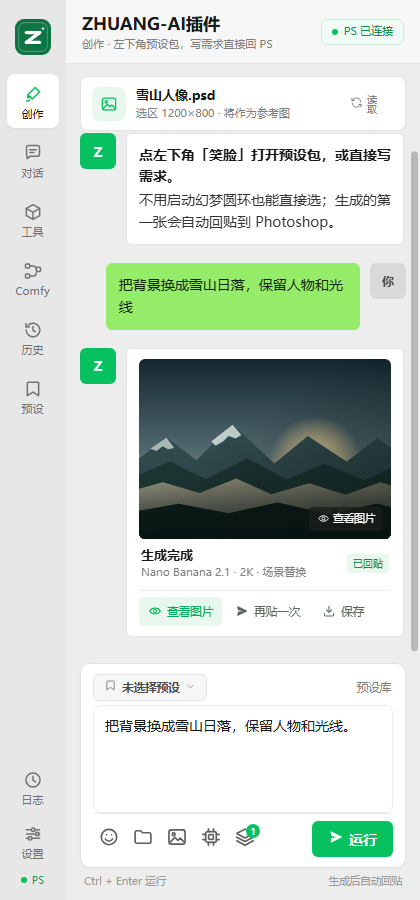 | 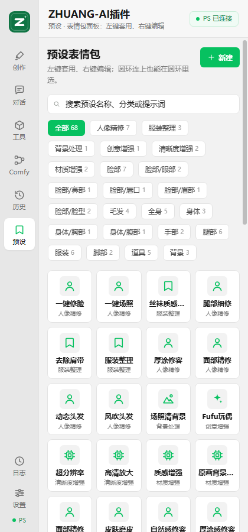 | 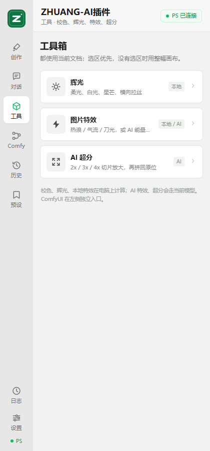 |

| 对话 | 历史 | 运行日志 |
| :---: | :---: | :---: |
| 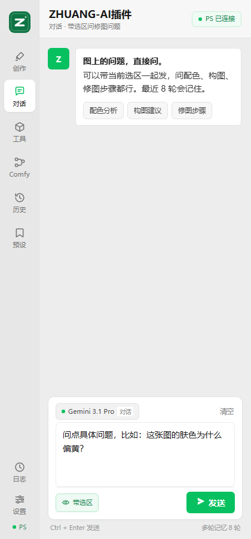 | 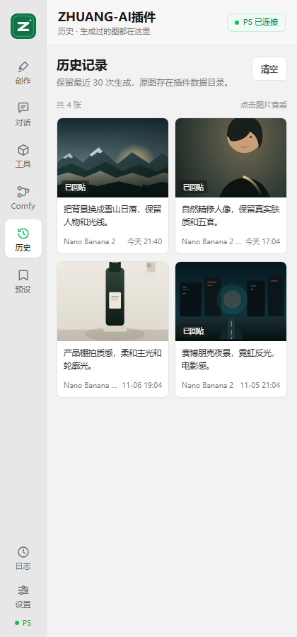 | 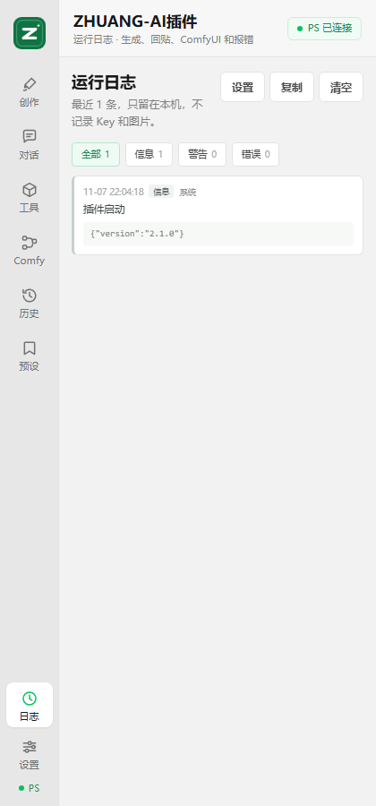 |

| 设置 · 外观 | 设置 · 模型 | 设置 · 连接 |
| :---: | :---: | :---: |
| 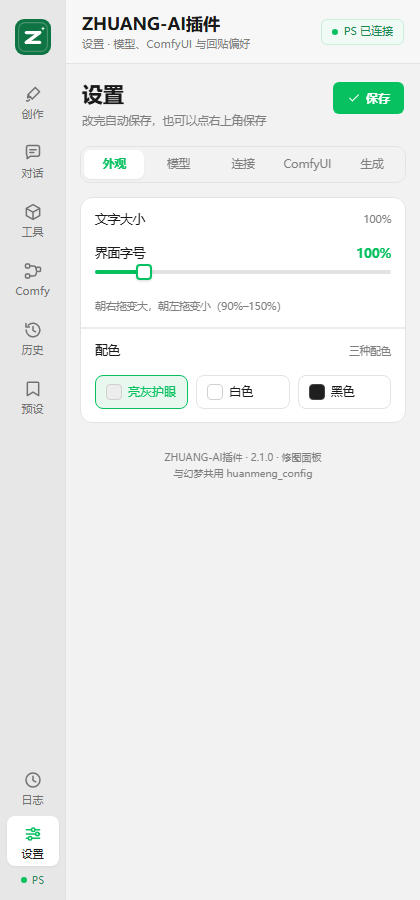 | 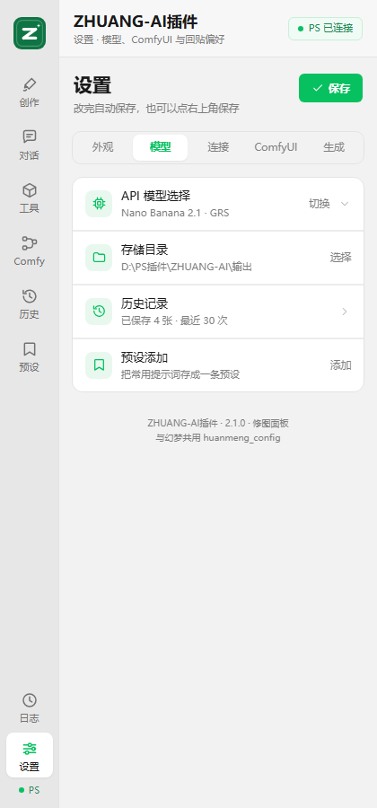 | 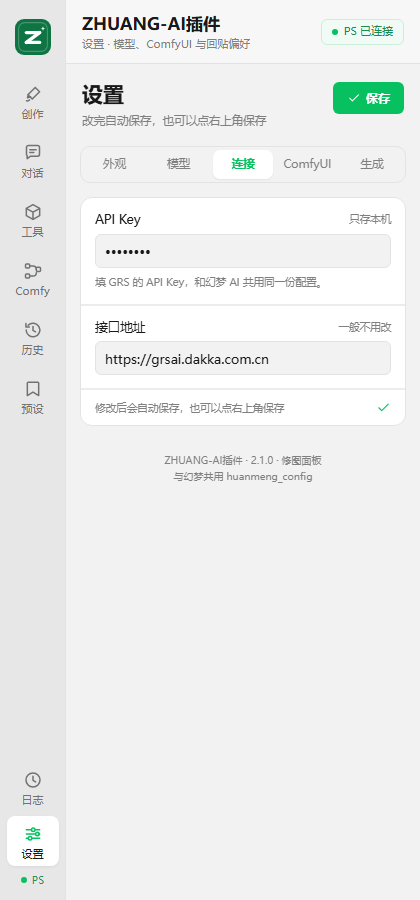 |

| 设置 · ComfyUI | 设置 · 生成 | 幻梦圆环 |
| :---: | :---: | :---: |
| 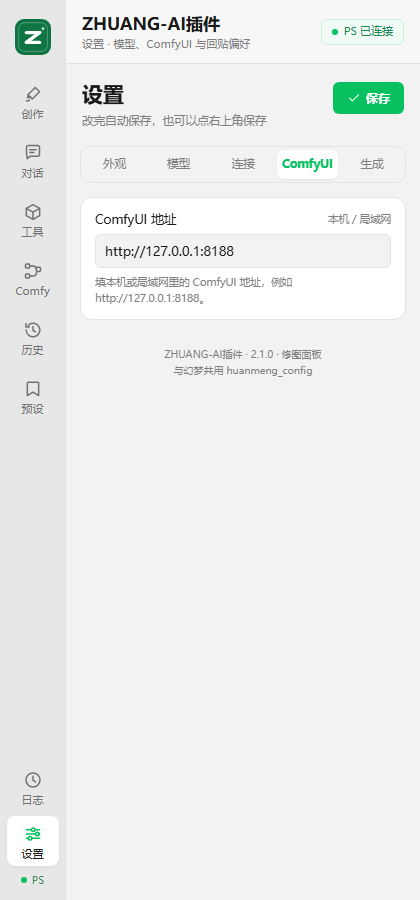 | 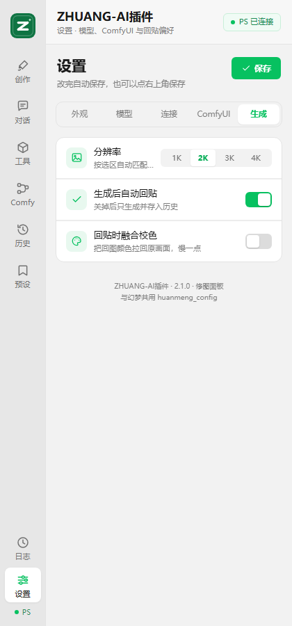 | 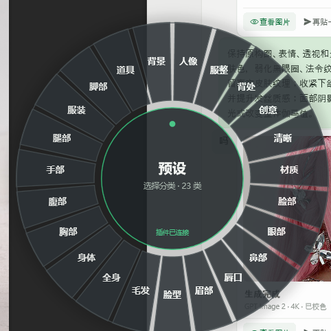 |

---

## 🚀 快速开始

### 前置要求

- **Adobe Photoshop 26.0 或更高版本**（UXP Manifest v5）
- **Adobe UXP Developer Tool**（推荐，在 Creative Cloud 桌面端直接安装）
- 可选（仅使用幻梦圆环时需要）：
  - **Windows**：Windows 10/11（自带 .NET Framework 4.8 与 PowerShell 5.1，**无需额外安装 .NET SDK**）
  - **macOS**：macOS 13+ 与 Xcode Command Line Tools（`xcode-select --install`）
- 可选：**本机或局域网 ComfyUI**（默认地址 `http://127.0.0.1:8188`）

### 1. 克隆仓库

```bash
git clone https://github.com/shengmojiaogexing/ZHUANG-AI.git
cd ZHUANG-AI
```

### 2. 安装 Photoshop UXP 插件

#### 方式 A：通过 UXP Developer Tool 加载（推荐）

1. 打开 Adobe **UXP Developer Tool**，点击 **Add Plugin**。
2. 选择仓库中的 [`plugin/manifest.json`](plugin/manifest.json)。
3. 点击条目右侧的 **Load**。
4. 回到 Photoshop，在顶部菜单 **增效工具 / 插件** 中打开 **ZHUANG-AI插件**。

#### 方式 B：复制到外部插件目录

将整个 `plugin/` 目录复制到以下路径后重启 Photoshop（不同系统或 PS 版本路径可能略有差异，找不到时优先使用方式 A）：

```text
# Windows 常见路径
C:\Program Files\Common Files\Adobe\UXP\Plugins\External\com.zhuang.ai.panel
```

### 3. 启动幻梦圆环（可选）

圆环启动后常驻托盘 / 菜单栏并监听 `ws://127.0.0.1:8799`，插件会自动连接同步：

```powershell
# Windows 推荐 · 构建并运行 C# / WPF 版（生成 幻梦圆环.exe，双击运行）
powershell -NoProfile -ExecutionPolicy Bypass -File ring/windows-csharp/build.ps1
.\ring\windows-csharp\幻梦圆环.exe

# Windows 备选 · 直接运行全功能 PowerShell 版
powershell -NoProfile -ExecutionPolicy Bypass -File ring/windows-powershell/HuanmengRing.ps1
```

```bash
# macOS · 编译打包并启动原生 Swift .app
cd ring/macos
bash scripts/build-app.sh
open dist/HuanmengRing.app
```

> 各平台圆环详细快捷键、配置项与排错见子目录说明：[`ring/windows-csharp/README.md`](ring/windows-csharp/README.md) · [`ring/macos/README.md`](ring/macos/README.md) · [`ring/windows-powershell/README.md`](ring/windows-powershell/README.md)。

### 4. 首次使用流程

1. 打开面板 → 进入 **设置 → 模型** 选择目标生图模型，在 **设置 → 连接** 填写对应渠道的 API Key（及可选代理/中转地址）。
2. 在 **设置 → 生成** 按需开启「生成后自动回贴」「回贴时融合校色」，并指定原图保存目录。
3. 在 Photoshop 中打开图片并框选局部区域（不框选则默认使用整幅画布）；可点击输入框左下角图标添加最多 3 张参考图或执行「智能抓取」。
4. 点击「笑脸」图标在表情包式预设抽屉中点选预设（或用 `Alt+右键` / `⌥+右键` 唤出幻梦圆环点选），调整并行张数（1–8 张）后点击 **运行**。

---

## 🔌 支持的模型渠道与预设库

### 云端生图渠道矩阵

| 渠道 | 标识 | 内置模型与说明 | 独立配置项 |
|---|---|---|---|
| **GRS** | `grs` | 同步 **17 个图片模型**：Nano Banana `2.1`（默认）/ `2` / `Pro` / `Lite` / `Fast` / `CL` / `VIP`、GPT Image `2` / `2.5` / `2.6`（按模型能力自动夹取 1K/2K/4K） | Key + 可选国内/自定义 URL |
| **Google AI Studio** | `google` | `Gemini 3.1 Flash Image`、`Gemini 3 Pro Image`（支持 1K/2K/4K） | Key + 官方或代理根地址 |
| **xAI** | `xai` | `Grok Imagine 2.0`、`Grok Imagine Quality`（自动收敛 1K/2K） | Key + 自定义 URL |
| **火山方舟 · SeeDream** | `volcengine` | `SeeDream 4.5`（2K/4K）、`SeeDream 5.0`（2K/3K）、`SeeDream 5.0 Pro` | Key + 自定义 URL |
| **Vertex AI** | `vertex-ai` | `Gemini 3.1 Flash Image`、`Gemini 3 Pro Image` | Key / 接入配置 |
| **OpenAI 兼容** | `openai` | `GPT Image 1`、`GPT Image 1 Mini` 及任意兼容端点 | Key + 自定义 Base URL |
| **New API 中转** | `newapi` | `GPT Image 1`、`Gemini 2.5 Flash Image` 及中转模型 | Key + 中转地址 |

> 所有渠道均支持在模型面板底部直接填写 **自定义模型名**；多轮对话模型自动跟随当前选中的渠道。

<details>
<summary><b>展开查看内置 68 条修图预设全览（23 个分类，与幻梦圆环双向同步）</b></summary>

首次启动会自动导入圆环内置的 68 条预设，后续可在插件中自由搜索、修改、新增或删除，并实时推送至在线圆环：

| 分类 | 数量 | 内置预设名称 |
|---|---:|---|
| 人像精修 | 7 | 一键修脸 · 一键场照 · 腿部细修 · 厚涂修容 · 面部精修 · 动态头发 · 风吹头发 |
| 脸部 | 7 | 面部精修 · 皮肤磨皮 · 自然感修容 · 厚涂感修容 · CG感修容 · 补妆(JSON) · 复制脸修容 |
| 腿部 | 6 | 修长美腿 · 丝袜优化+高亮 · 腿部中性灰精修 · 腿部勒肉感 · 白丝生成优化 · 肉色裸感丝袜 |
| 服装 | 6 | 连体黑丝生成 · 安全裤转丝袜 · 去胸衣打底 · 去打底裤 · 服装破损修复 · 肩带内衣带移除 |
| 全身 | 5 | 体毛移除 · 关节美白 · 超清修复 · 场照轮椅一键处理 · 2D转3D植入 |
| 道具 | 5 | 道具接缝消除 · 道具清洁翻新 · 道具表面精度提升 · 道具套装材质统一 · 宝石镶嵌物优化 |
| 毛发 | 4 | 头发优化(JSON) · 亮闪闪头发 · 动态头发(画笔引导) · 长发飘动风吹 |
| 服装整理 | 3 | 丝袜质感提升 · 去除肩带 · 服装整理 |
| 身体 | 3 | 身材优化 · 绷紧衣服 · 抹油勒肉 |
| 背景 | 3 | 场照去背景 · 白棚处理 · 场照除杂 |
| 清晰度增强 | 2 | 超分辨率 · 高清放大 |
| 材质增强 | 2 | 质感增强 · 原画背景2D转3D |
| 脸部/眼部 | 2 | 瞳孔提亮 · 精致眼妆 |
| 脸部/脸型 | 2 | 下颌线优化 · 御姐脸型(可调参数) |
| 手部 | 2 | 手指纤细美化 · 美甲优化生成 |
| 脚部 | 2 | 脚部清洁美化 · 脚部形态优化 |
| 其他分类（各 1 条） | 7 | 背景处理（场照清背景）· 创意增强（Fufu玩偶）· 脸部/鼻部（鼻梁高光）· 脸部/唇口（柔化唇纹）· 脸部/眉部（精致眉形）· 身体/胸部（胸部扩大）· 身体/腹部（腹肌线条） |

</details>

<details>
<summary><b>展开查看 WebSocket 桥接协议与本机数据存储位置</b></summary>

#### 1. 幻梦圆环 ↔ 插件 WebSocket 协议（`ws://127.0.0.1:8799`）
- **圆环 → 插件**：连接后发送 `hello`（含应用名、版本、操作系统）；用户点击预设后发送 `command` / `applyPreset`，携带 `{ name, category }`，插件按「分类 + 名称」精确匹配填词，避免同名预设串条。
- **插件 → 圆环**：连接及预设变动时推送 `state`（含 `payload.presets`），圆环实时刷新并原子写入本地备份。

#### 2. 本机数据存储清单
| 数据类型 | 存储位置 |
|---|---|
| API Key / 模型 / 分辨率 | `localStorage['huanmeng_config']`（与幻梦 AI 兼容共用） |
| 外观偏好（字号/主题）/ 目录令牌 / 草稿 | `localStorage['zhuang_ai_ui_v1']` |
| 插件预设库（含圆环 + 自定义） | `localStorage['zhuang_ai_presets_v1']` |
| 历史索引与缩略图 / 原图 | `localStorage['zhuang_ai_history_v1']` + UXP 数据目录 `history/`（最多 30 条） |
| 本地 ComfyUI 地址 | `localStorage['zhuang_ai_comfy_local_url_v1']` |
| 圆环配置与同步预设缓存 | `~/.huanmeng-ring.json` · `~/.huanmeng-presets.json`（首次覆盖前自动备份 `.backup.json`） |

</details>

---

## 🧪 本地 ComfyUI 与内置工作流

- **自动读取工作流**：在 **设置 → ComfyUI** 配置本机或局域网地址（默认 `http://127.0.0.1:8188`），切到左侧 **ComfyUI** 页面即自动调用 `/userdata?dir=workflows&full_info=true` 列出工作流，并通过 `/object_info` 将界面 JSON 自动转换为 API 格式。
- **两份开箱即用内置工作流**（位于 [`plugin/js/workflows-builtin.js`](plugin/js/workflows-builtin.js)）：
  - **内置 · 图生图带放大（默认）**：主图节点标记为 `#06 主图`，点击旁边的「读取选区」即可直接把 Photoshop 当前选区以原始字节（`ArrayBuffer`）上传至 `/upload/image` 并自动填入文件名。
  - **内置 · 文生图带放大**：暴露 `#01 正向提示词`、`#02 LoRA`、`#03 画幅` 参数（运行前请先在 `#02 LoRA` 选择本机模型）。
- **`#` 参数精简表单**：面板只渲染工作流中带 `#` 标记的参数节点，提交前自动校验空主图与未选必填项，防止无效请求。

---

## 🛠️ 开发与调试

### 1. 插件开发与浏览器界面预览

插件**没有任何构建步骤**，修改 `plugin/` 下的 HTML / CSS / JS 后，直接在 UXP Developer Tool 中点击 **Reload** 即可生效。

如需脱离 Photoshop 在普通浏览器中调试 UI（加载 [`plugin/js/demo.js`](plugin/js/demo.js) 模拟数据，Photoshop 宿主加载 `index.html` 时不会引入 demo）：

```bash
cd plugin
python -m http.server 8765
# 浏览器打开 http://127.0.0.1:8765/preview.html
```

### 2. 幻梦圆环常用命令与参数

```powershell
# Windows C# 版：编译 + 启动时直接唤出圆环
powershell -NoProfile -ExecutionPolicy Bypass -File ring/windows-csharp/build.ps1
.\ring\windows-csharp\幻梦圆环.exe --show

# Windows PowerShell 版：环境自检 / 接口连通性测试
powershell -NoProfile -ExecutionPolicy Bypass -File ring/windows-powershell/HuanmengRing.ps1 --doctor
powershell -NoProfile -ExecutionPolicy Bypass -File ring/windows-powershell/HuanmengRing.ps1 --chat-test
```

```bash
# macOS 版：编译打包 + 启动直接唤出圆环
cd ring/macos && bash scripts/build-app.sh
open dist/HuanmengRing.app --args --show
```

---

## 🗂️ 项目结构

```text
ZHUANG-AI/
├── README.md                       # 项目主说明文档
├── LICENSE                         # 本项目 GNU GPL-3.0 许可证全文
├── LICENSE-Apache-2.0.txt          # 第三方 Apache-2.0 组件许可证全文
├── NOTICE                          # 第三方开源组件署名与修改声明
├── docs/                           # 品牌 Logo 与 12 张面板/圆环截图
├── plugin/                         # ★ Photoshop UXP 面板源码（无构建步骤）
│   ├── manifest.json               # UXP Manifest v5（要求 Photoshop 26.0+）
│   ├── index.html / preview.html   # PS 面板入口 / 浏览器演示页入口
│   ├── styles.css / theme.css / tools.css / wechat.css
│   ├── assets/                     # 自包含内联 SVG 品牌徽章与单色标记
│   ├── js/                         # UI 主流程、预设、圆环桥接、自绘滚动条、日志与内置工作流
│   └── lib/                        # 核心能力模块（多渠道生图、精准回贴、融合校色、辉光、特效、超分、ComfyUI）
└── ring/                           # ★ 幻梦圆环伴侣端（可选，ws://127.0.0.1:8799）
    ├── windows-csharp/             # Windows C# / WPF 轻量重写版（build.ps1 零 SDK 编译）
    ├── macos/                      # macOS Swift 5.9+ / SwiftPM 原生版（scripts/build-app.sh）
    └── windows-powershell/         # Windows PowerShell 5.1 旧版全功能实现
```

---

## ❓ 常见问题

<details>
<summary><b>不启动幻梦圆环，能正常使用插件和 68 条预设吗？</b></summary>

可以。幻梦圆环是完全可选的伴侣端：点击插件输入框左下角「笑脸」即可打开微信表情包式预设抽屉，或在左侧「预设」页搜索、套用和编辑全部预设；圆环未启动时仅显示未连接状态点，并在后台自动重连。

</details>

<details>
<summary><b>大图或 16-bit 文档回贴会偏移吗？回贴后怎么局部擦除？</b></summary>

插件在回贴链路中采用了「选区 DOM 优先 + `batchPlay` 回退」与「置入、缩放、栅格化后二次对齐目标矩形」机制，大幅降低大图和 16-bit 文档的错位风险。回贴完成后会自动放入同名图层组并附带白色蒙版，直接用黑色画笔涂抹即可局部擦除。

</details>

<details>
<summary><b>macOS 上按 ⌥+鼠标右键没反应怎么办？</b></summary>

`⌥+右键` 依赖系统 `CGEventTap`，需要授予「辅助功能」权限：点击菜单栏圆环图标 →「授予辅助功能权限」，在「系统设置 → 隐私与安全性 → 辅助功能」中勾选 **HuanmengRing**。每次重新编译因 ad-hoc 签名变化，需重新勾选一次（顽固时可执行 `tccutil reset Accessibility com.huanmeng.ring` 后重授）。

</details>

<details>
<summary><b>连接本地 ComfyUI 时提示主图为空或上传报 500 怎么排查？</b></summary>

请先确认 **设置 → ComfyUI** 中的地址（默认 `http://127.0.0.1:8188`）可正常访问，且 ComfyUI 正在运行；内置「图生图带放大」工作流需先点击 `#06 主图` 旁的「读取选区」上传图像后再运行，内置「文生图带放大」需先在 `#02 LoRA` 中选择本机已有的 LoRA 文件。

</details>

<details>
<summary><b>换用新版后，为什么提示重新填写 API Key 或端口 8799 被占用？</b></summary>

- **端口占用**：Windows / macOS 同时只能运行一个圆环实例，若 `8799` 被旧版圆环占用，请先完全退出旧版再启动新版。
- **配置标识**：面板内部标识已统一为 `com.zhuang.ai.panel` 与 `zhuang_ai_*`；API Key 存储键仍兼容 `localStorage['huanmeng_config']`，若从更早非兼容版本迁移，请在「设置 → 连接」重新确认 Key 与模型。

</details>

---

## 📦 开源组件与致谢清单

本项目的部分模块来自 / 参考了以下优秀开源作品。**所有第三方开源组件均保留其原始版权与开源许可协议**，完整署名、修改声明与许可证兼容关系见仓库根目录的 **[`NOTICE`](NOTICE)**：

| 开源作品 | 作者 | 许可证 | 在本项目中的对应内容 |
|---|---|---|---|
| **PixelRunner / 小T修图助手（像素起子）** | XIAOTsune | [Apache-2.0](LICENSE-Apache-2.0.txt) | `plugin/lib/glow-engine.js` 辉光 CPU 引擎（照搬并修改，工具箱交互思路亦有参考） |
| **[Blendrr / AI-Assisted-Image-Editing-for-Photoshop](https://github.com/deewong7/AI-Assisted-Image-Editing-for-Photoshop)** | deewong7 | GPL-3.0 | `plugin/lib/provider-models.js` 等文件中 SeeDream / Nano Banana / Grok Imagine 的模型目录、分辨率与请求参数（改写裁剪） |
| **图像对齐算法** | 草鱼 | GPL-3.0 | `plugin/lib/color-match.service.js` 中智能对齐相关实现与栅格化后二次对齐思路（原仓库已不可访问） |
| **[ComfyUI](https://github.com/comfyanonymous/ComfyUI)** | ComfyUI 作者 | GPL-3.0 | HTTP API 接口行为与工作流格式参考（`plugin/lib/comfy-*.js` 为独立实现，未复制源码） |

- Apache-2.0 来源许可证全文见 **[`LICENSE-Apache-2.0.txt`](LICENSE-Apache-2.0.txt)**（兼容方向：`Apache-2.0 → GPL-3.0`）。
- 再分发包含上述代码的衍生版本时，请务必一并保留 **[`NOTICE`](NOTICE)** 与 **[`LICENSE-Apache-2.0.txt`](LICENSE-Apache-2.0.txt)**。

---

## ⚖️ 许可协议与免责声明

- **开源协议**：本项目原创代码与文档基于 **[GNU General Public License v3.0 (GPL-3.0)](LICENSE)** 开源发布。任何修改或衍生作品在分发时须遵循相同 GPL-3.0 协议并保留版权声明；上述第三方开源作品均适用其各自原始许可协议。
- **免责声明**：本项目仅供学习与技术交流，按「现状（AS-IS）」提供，不提供任何明示或暗示担保；与 Adobe 及各 AI 模型服务商无任何隶属或授权关系。使用第三方 AI 服务产生的费用、内容合规与版权责任由使用者自行承担，请勿用于违法或侵权用途。
- **版权声明**：`Copyright (C) 2026 ZhuangZe-ZERO (shengmojiaogexing)`

<div align="center">
<sub>ZHUANG-AI · Photoshop AI Retouching Panel + Huanmeng Ring · GPL-3.0 · 欢迎点个 ⭐ Star 支持开源</sub>
</div>
