# ZHUANG-AI

**ZHUANG-AI（庄 AI）** 是一套面向 Photoshop 的 AI 修图工具：一个原生 UXP 面板 + 一个浮在画布上的预设圆环菜单。以 **GPL-3.0** 开源。

> ZHUANG-AI is a Photoshop AI retouching toolkit (UXP panel + preset ring menu). Open source under GPL-3.0.

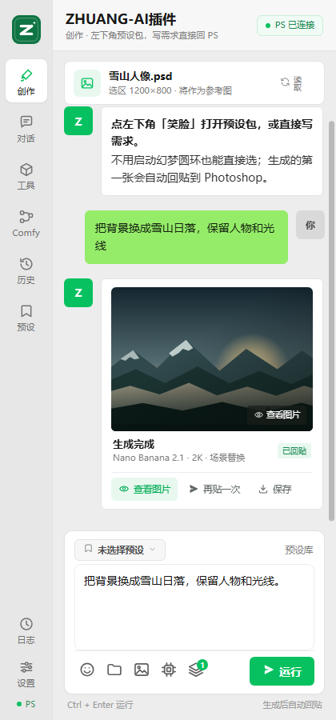

## 仓库内容

| 目录 | 说明 |
| --- | --- |
| [`plugin/`](plugin/) | **ZHUANG-AI插件**：Photoshop UXP 面板（需要 Photoshop 26.0+） |
| [`ring/windows-csharp/`](ring/windows-csharp/) | 幻梦圆环 Windows 版（C# / WPF，.NET Framework 4.8） |
| [`ring/macos/`](ring/macos/) | 幻梦圆环 macOS 版（Swift 6 / SwiftPM） |
| [`ring/windows-powershell/`](ring/windows-powershell/) | 幻梦圆环旧版 PowerShell 实现（功能最全） |

## 插件功能

- **预设 → 提示词 → 运行 → 回贴**：选区自动当参考图；没有选区时用整幅画布。
- **精确回贴**：选区先走 DOM，读不到再走 batchPlay；置入 / 缩放 / 栅格化后再对齐一次。回贴结果自动放进同名图层组并加白色蒙版。
- **多图并行**：一次 1–8 张同时请求，首张自动回贴，其余以结果卡片展示，点「回贴 PS」再挑。
- **后台生成**：生成期间可以切去修别的图，回贴时自动切回原文件，贴完再切回你正在编辑的文件。
- **参考图 / 智能抓取**：最多 3 张；有选区抓选区，没有就抓整幅画布（按最长边 1400px 读取）。
- **预设**：内置 68 条（23 个分类），与幻梦圆环实时同步；微信表情包式选择面板，支持搜索、分类、编辑。
- **对话**：多轮文字 / 带选区视觉问答，记忆 8 轮。
- **本地工具**：辉光、图片特效、AI 超分（2× / 3× / 4× 切片）。
- **ComfyUI**：本机 / 局域网 ComfyUI，自动读取工作流列表与 `#` 参数表单，可直接把 PS 选区上传成主图。
- **外观**：微信风界面，字号 90%–150%，亮灰 / 白 / 黑三种配色。

支持渠道：GRS、Google AI Studio、xAI、火山方舟 SeeDream、Vertex AI、OpenAI 兼容、New API 中转。

## 安装

### 插件

1. 安装 Adobe **UXP Developer Tool**（在 Creative Cloud 里搜索）。
2. **Add Plugin** → 选 `plugin/manifest.json`。
3. 点 **Load**，回到 Photoshop → **增效工具 / 插件** → **ZHUANG-AI插件**。

也可以把 `plugin/` 整个复制到 `C:\Program Files\Common Files\Adobe\UXP\Plugins\External\com.zhuang.ai.panel`，然后重启 Photoshop。

### 圆环（可选）

- **Windows C#**：`powershell -File ring/windows-csharp/build.ps1` 生成 `幻梦圆环.exe`，双击运行。
- **Windows PowerShell**：`powershell -NoProfile -ExecutionPolicy Bypass -File ring/windows-powershell/HuanmengRing.ps1`
- **macOS**：`bash ring/macos/scripts/build-app.sh` 生成 `dist/HuanmengRing.app`。

圆环是 WebSocket 服务端（`ws://127.0.0.1:8799`），插件启动后自动连接；不启动圆环也能在插件里直接选预设。

## 截图

| 创作 | 预设 | 工具 |
| --- | --- | --- |
|  | 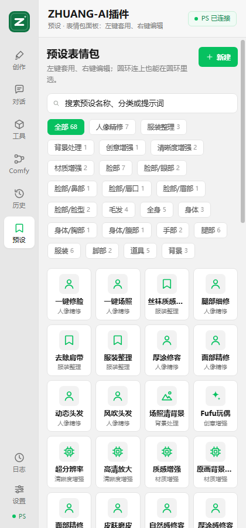 | 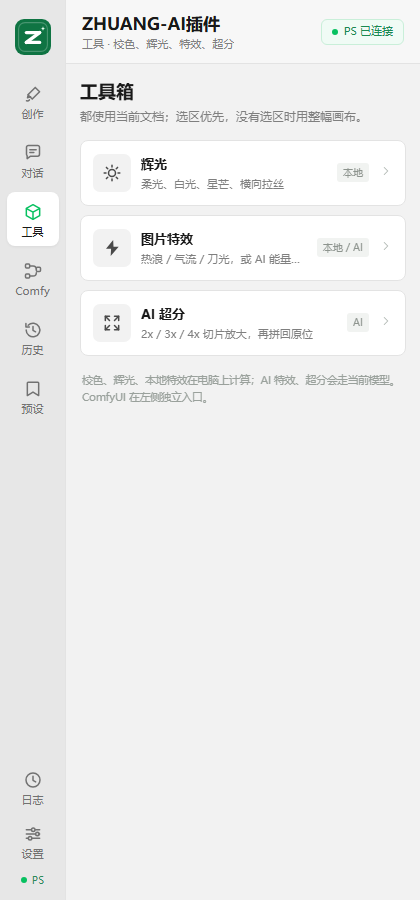 |

| 对话 | 历史 | 运行日志 |
| --- | --- | --- |
| 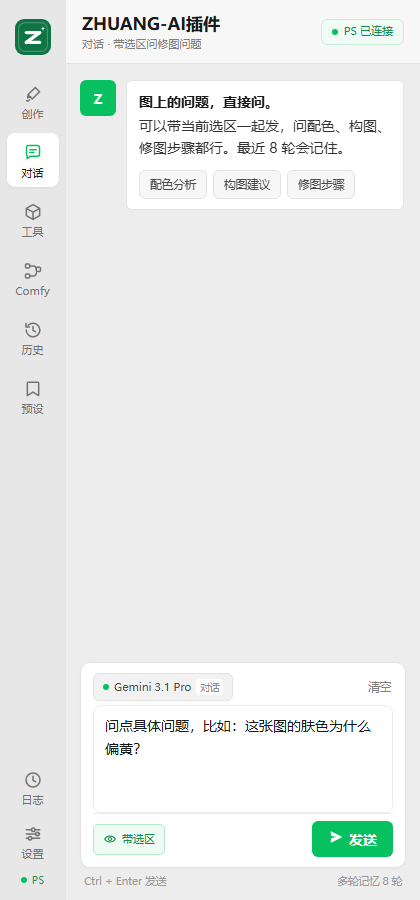 | 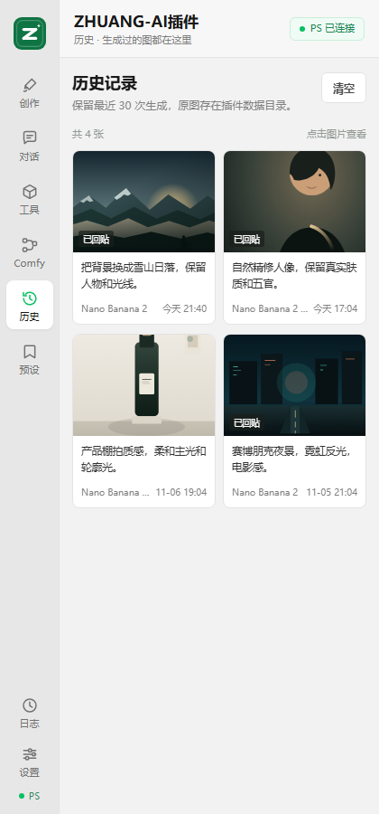 | 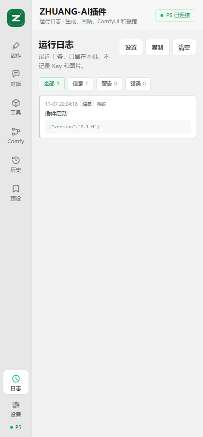 |

| 设置 · 外观 | 设置 · 模型 | 设置 · 连接 |
| --- | --- | --- |
| 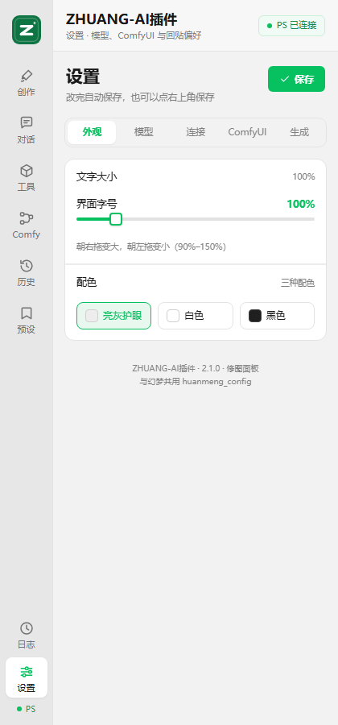 | 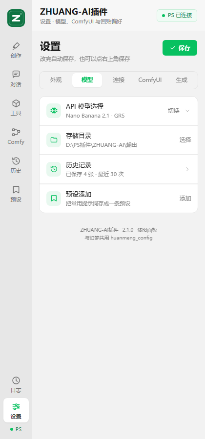 | 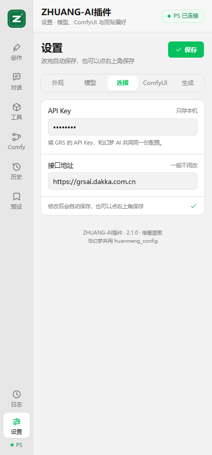 |

| 设置 · ComfyUI | 设置 · 生成 | 幻梦圆环 |
| --- | --- | --- |
| 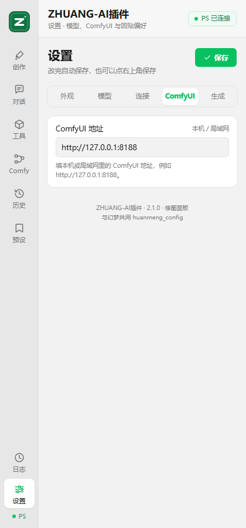 | 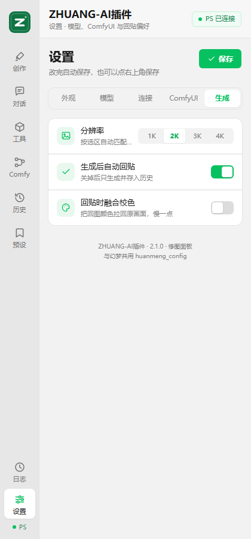 | 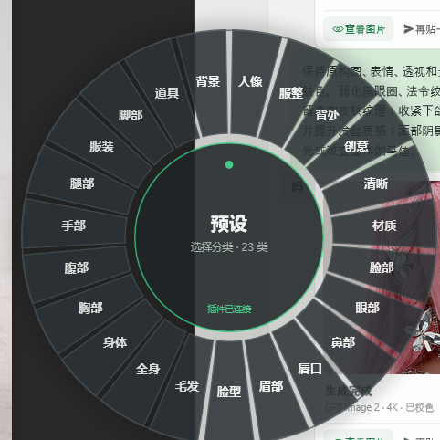 |

## 致谢与第三方组件

本项目的部分模块来自 / 参考了以下开源作品，完整署名与许可证条件见 [NOTICE](NOTICE)：

| 作品 | 作者 | 许可证 | 在本项目中的对应内容 |
| --- | --- | --- | --- |
| PixelRunner / 小T修图助手（像素起子） | XIAOTsune | Apache-2.0 | `plugin/lib/glow-engine.js` 辉光 CPU 引擎（照搬并修改） |
| [Blendrr / AI-Assisted-Image-Editing-for-Photoshop](https://github.com/deewong7/AI-Assisted-Image-Editing-for-Photoshop) | deewong7 | GPL-3.0 | `plugin/lib/provider-models.js` 等文件中 SeeDream / Nano Banana / Grok Imagine 的模型目录、分辨率与请求参数（改写裁剪） |
| 图像对齐算法 | 草鱼 | GPL-3.0 | `plugin/lib/color-match.service.js` 的智能对齐相关实现（原仓库已不可访问） |
| [ComfyUI](https://github.com/comfyanonymous/ComfyUI) | ComfyUI 作者 | GPL-3.0 | 接口与工作流格式参考（独立实现，未复制源码） |

- Apache-2.0 来源的许可证全文：[LICENSE-Apache-2.0.txt](LICENSE-Apache-2.0.txt)
- 再分发包含上述代码的版本时，请保留 [NOTICE](NOTICE) 与 Apache-2.0 许可证副本。

## 数据与隐私

- API Key 只保存在本机（浏览器 / UXP 的 `localStorage` 或用户目录下的配置文件），不会上传到本仓库或作者服务器。
- 仓库不包含任何 API Key、授权码、云端地址或签名密钥。
- 生成时图片会发往你自己配置的 AI 服务商，请遵守对应服务的条款。

## 开发

- 插件没有构建步骤：在 UXP Developer Tool 里改完文件点 **Reload**。
- 浏览器预览界面：

```bash
cd plugin
python -m http.server 8765
# 打开 http://127.0.0.1:8765/preview.html
```

- 圆环各平台的构建与使用见对应子目录的 README。

## 许可证

本项目以 **GNU General Public License v3.0（GPL-3.0）** 发布，完整条款见 [LICENSE](LICENSE)。

本项目包含的第三方作品署名与许可证条件见 [NOTICE](NOTICE)；其中 Apache-2.0 来源同时附有 [LICENSE-Apache-2.0.txt](LICENSE-Apache-2.0.txt)。

Copyright (C) 2026 ZhuangZe-ZERO (shengmojiaogexing)

## 免责声明

本项目仅供学习与技术交流。使用第三方 AI 服务产生的费用、内容合规与版权责任由使用者自行承担；请勿用于违法或侵权用途。
