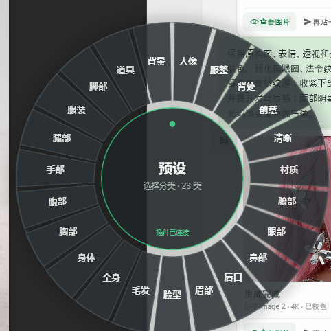

# 幻梦圆环 · macOS 版（按 Windows C# 版重构）

这是按 `幻梦圆环-CSharp`（Windows WPF 重写版）的功能范围，把 macOS 版重写成同一套东西：

**只保留圆环扇区菜单、全局热键、菜单栏常驻、预设分类 / 选择 / 复制 / 套用到插件，以及配置和预设数据兼容。**

旧 macOS 版里的生图、对话、截图、ComfyUI、图库、偏好设置窗口、自检等一律不再迁入 —— 和 C# 版
README 里写的边界保持一致；需要那些功能继续用旧的 `HuanmengRing.app` / 旧源码备份。



---

## 一、能力对照（C# → Swift）

| Windows C# | macOS Swift | 说明 |
| --- | --- | --- |
| `Program.cs` | `main.swift` | 单实例、未处理异常、`--show` |
| `AppConfig.cs` | `AppConfig.swift` | `~/.huanmeng-ring.json` 字段、默认值、上下限逐字对齐 |
| `PresetStore.cs` | `PresetStore.swift` | 本地/插件预设、分类、备份、原子写 |
| `BridgeServer.cs` | `BridgeServer.swift` | 127.0.0.1 WebSocket 服务端，插件是客户端 |
| `AltRightHook.cs` | `AltRightClickTap.swift` | Windows Alt+右键 → macOS ⌥+右键（CGEventTap） |
| `AppController.cs` | `AppController.swift` + `HotkeyManager.swift` | 托盘→菜单栏、热键、桥接装配、套用预设、气泡 |
| `RingWindow.cs` | `RingModel.swift` + `RingView.swift` + `RingWindow.swift` | 扇区、命中、动画、主题、键盘/鼠标交互 |
| （WPF 气泡） | `ToastWindow.swift` | 菜单栏气泡提示 |

---

## 二、在 Mac 上编译

前提：Mac 装过 Xcode Command Line Tools（`xcode-select --install`）。旧版 `.app` 就是用
Swift 6.2 工具链直接 `swift build` 出来的，这套代码同样不需要 Xcode 工程。

### 1. 拷贝本目录到 Mac（任意位置都行）

把 Windows 上的 `幻梦圆环-Mac` 整个文件夹拷到 Mac，放到任意目录都可以，例如：

```text
~/Documents/HuanmengRing-mac
```

它本身就是一个完整 SwiftPM 工程，**不覆盖旧工程也能直接编译**。目录结构：

```text
HuanmengRing-mac/
├─ Package.swift
├─ Sources/HuanmengRing/*.swift
├─ Resources/Info.plist / presets.json / AppIcon.icns
├─ scripts/build-app.sh
├─ docs/CONTRACTS.md
└─ README.md
```

如果想让它接替旧工程（以后从同一路径编译），先把旧目录改名备份：

```bash
cd "~/Documents/HuanmengRing/native"   # 路径以你机器为准
mv HuanmengRing HuanmengRing-old-$(date +%Y%m%d)
mv ~/Documents/HuanmengRing-mac HuanmengRing
```

（旧工程路径可以从旧 `.app` 的构建路径看；找 `Package.swift` 里
`name = "HuanmengRing"` 的那层目录即可。）

### 2. 编译打包

```bash
cd ~/Documents/HuanmengRing-mac        # 或替换后的 native/HuanmengRing
bash scripts/build-app.sh
```

产物：

```text
dist/HuanmengRing.app
```

脚本做四件事：`swift build -c release` → 组装 `.app` 骨架 → 拷 `presets.json` / 图标 →
ad-hoc 签名（Apple Silicon 上必须，否则启动即被杀）。

### 3. 运行

```bash
open "dist/HuanmengRing.app"                 # 静默常驻菜单栏
open "dist/HuanmengRing.app" --args --show   # 启动后直接唤出圆环
```

第一次从 Finder 双击如果被 Gatekeeper 拦，右键 →「打开」一次即可；从网络盘拷过来的包可以

```bash
xattr -dr com.apple.quarantine "dist/HuanmengRing.app"
```

之后把 `.app` 拖到 `/Applications` 也能正常用。

---

## 三、使用

- **⌥⌘R**：唤出/收回圆环（默认热键，可在配置里改）
- **⌥ + 鼠标右键**：在光标位置唤出圆环（对应 Windows 版的 Alt+右键）
  - 需要「辅助功能」权限；菜单栏图标 →「⚠️ 点这里授予辅助功能权限」，在
    「系统设置 → 隐私与安全性 → 辅助功能」里打开 **HuanmengRing** 的开关
- 菜单栏图标：显示圆环 / 插件连接状态 / 重载本地预设 / 打开预设文件 / 打开配置文件 / 退出
- 圆环操作（和 Windows 版一致）：
  - 点分类扇区进入预设层
  - 点预设：复制提示词 + 通过 WebSocket 发给插件
  - `Esc` / `←` / `Backspace` / 右键：预设层返回分类层，分类层关闭
  - 数字键 `1-9`：选择对应扇区
  - 点圆环外：关闭
  - 中心圆盘：预设层点它返回分类层，分类层点它关闭
- 热键被占用时会自动依次尝试 `⌥⇧⌘R`、`⌥⇧⌘F9`，菜单栏文字显示实际生效的组合。

### 热键在 mac 上的映射

配置里的 `interaction.hotkey` 沿用 Windows 写法；mac 端解析规则：

| 配置文本 | macOS 上 |
| --- | --- |
| `ctrl` / `control` | ⌃ Control |
| `alt` / `option` | ⌥ Option |
| `shift` | ⇧ Shift |
| `cmd` / `command` / `win` / `windows` | ⌘ Command |
| `a`-`z`、`0`-`9`、`f1`-`f20`、`space`、`enter`、`esc`、`tab`、`backspace` | 对应按键 |

但 **Windows 版默认值 `ctrl+alt+r` 在 mac 上会自动迁移成 ⌥⌘R**（旧 mac 版也是这个组合，
免得老配置在 mac 上变成别扭的 ⌃⌥R）。想用真正的 Control+Option+R，把配置写成
`control+alt+r` 即可。改完配置重开圆环生效。

---

## 四、和插件共用数据

数据源优先级与 Windows 版完全一致：

1. 插件在线时，接收插件推来的 `state.payload.presets`，实时刷新；
2. 把这份预设写回 `~/.huanmeng-presets.json`（第一次覆盖前备份到
   `~/.huanmeng-presets.backup.json`）；
3. 插件不在线时，读这个本地文件；本地文件不存在时用包内 `Resources/presets.json` 复制一份。

配置读取 `~/.huanmeng-ring.json`，和 Windows 版 / 旧 mac 版是同一个文件、同一套键名：

- `port`：桥接端口，默认 `8799`
- `interaction.hotkey` / `altRightClick` / `altRightClickScope`（`global` / `photoshop` / `off`）
- `appearance.outerRadius` / `bandRatio` / `opacity` / `theme`（`slate` 深色 / `light` 浅色）/ `animation`
- `appearance.popDistance` / `gapRatio` / `gapMax`
- `appearance.shadowEnabled` / `shadowBlur` / `shadowOffsetY` / `shadowAlpha`
- `appearance.showDirectionLine` / `appearScale`
- `content.presetAction`：仍读取，但新版固定「复制 + 套用」，这样插件才会自动填提示词

不会写回配置里的其它字段。

### 插件桥接协议

圆环是 WebSocket 服务端（只绑 `127.0.0.1`），插件是客户端：

```text
ws://127.0.0.1:8799
```

- 圆环 → 插件：`hello`（`{type:"hello", app:"幻梦圆环", version:"2.0.0", os:"macos"}`）
- 圆环 ← 插件：`state`，读取 `payload.presets`
- 圆环 → 插件：`command` / `action:"applyPreset"`，`payload` 带 `{ name, category }`

插件侧对应 `plugin/js/ring-bridge.js`，mac / Windows 通用。

---

## 五、和 Windows 版的差异（mac 必须做的适配）

- 托盘 → 菜单栏 `NSStatusItem`；气泡提示 → 右上角自绘 Toast（约 2.2 秒消失）。
- Windows 低级鼠标钩子 → CGEventTap；**⌥+右键需要辅助功能权限**，快捷键不需要。
- ad-hoc 签名每次重编译都会变，系统「辅助功能」里的旧授权会失效：
  菜单栏 →「点这里授予辅助功能权限」重新勾选；顽固时执行
  `tccutil reset Accessibility com.huanmeng.ring` 再重新授权。
- 单实例：C# 命名 Mutex → `~/.huanmeng-ring.lock` 的 flock；第二个实例带 `--show`
  启动会通知已运行实例唤出圆环。
- 「打开预设文件」用 Finder 选中文件（对应 Windows 的 explorer /select）。
- 多了一个「打开配置文件」菜单项（mac 没有偏好设置窗口，改配置靠它）。
- 日志在 `$TMPDIR/huanmeng-ring-mac.log`（`echo $TMPDIR` 可看具体路径）。

---

## 六、已知边界

- 圆环不负责出图 / 对话 / ComfyUI / 选区 / 语音 / 图库 —— 与 C# 版一致，没有迁入。
- 预设分类完全跟插件 / 本地预设文件走，圆环不单独编辑预设。
- 热键注册失败时仍可用菜单栏或 ⌥右键打开。
- `8799` 被旧版圆环占用时桥接会启动失败，菜单栏/圆环会提示；先退出旧版再启动。
- 圆环只覆盖鼠标所在的那块屏幕；多屏时鼠标在哪块屏幕就在哪块屏幕唤出。
- `theme` 目前支持 `slate` / `light`，其它值按 `slate` 处理。

---

## 七、排错

| 现象 | 处理 |
| --- | --- |
| `swift build` 报错 | 把 `swift --version`、`xcode-select -p` 和完整报错贴回来（第一次编译可能需要 `rm -rf .build`） |
| 双击没反应 / 一闪而过 | 终端跑 `"dist/HuanmengRing.app/Contents/MacOS/HuanmengRing"` 看输出；或看 `$TMPDIR/huanmeng-ring-mac.log` |
| ⌥右键没反应 | 辅助功能权限未给；菜单栏 →「⚠️ 点这里授予辅助功能权限」；列表里显示的是 **HuanmengRing**（文件名），不是「幻梦圆环」 |
| 圆环显示「插件未连接」 | PS 里没开 ZHUANG-AI 插件，或端口被旧圆环占着：`lsof -i :8799` |
| 热键没反应 | 被别的程序占用，看菜单栏「显示圆环 (实际热键)」；或在配置里换一个组合 |
| 编译/运行问题想回滚 | 用第一节备份的旧工程重新 `build`，或直接用备份的旧 `.app` |

重新编译后如果 ⌥右键失灵，先重新授权辅助功能，再重启圆环。

---

## 八、文件结构

```text
HuanmengRing/
├─ Package.swift                 SwiftPM 包定义（macOS 13+，无第三方依赖）
├─ Sources/HuanmengRing/
│  ├─ main.swift                 入口 / 单实例 / 未处理异常
│  ├─ AppDelegate.swift          NSApplicationDelegate
│  ├─ AppController.swift        菜单栏、热键、⌥右键、桥接、套用预设、Toast 装配
│  ├─ AppConfig.swift            配置 / 热键解析 / 路径 / 日志 / JSON 工具
│  ├─ PresetStore.swift          本地 / 插件预设、分类、备份、原子写
│  ├─ BridgeServer.swift         127.0.0.1 WebSocket 服务端（手写握手/帧）
│  ├─ HotkeyManager.swift        Carbon 全局热键
│  ├─ AltRightClickTap.swift     CGEventTap 监听 ⌥+右键
│  ├─ RingModel.swift            圆环状态（层、悬停、预设项、动画）
│  ├─ RingView.swift             SwiftUI Canvas 绘制
│  ├─ RingWindow.swift           透明置顶 NSPanel + 命中/键盘/动画
│  └─ ToastWindow.swift          右上角气泡
├─ Resources/Info.plist / presets.json / AppIcon.icns
├─ scripts/build-app.sh          swift build + 组装 .app + ad-hoc 签名
└─ docs/CONTRACTS.md             模块接口契约（内部开发用）
```
